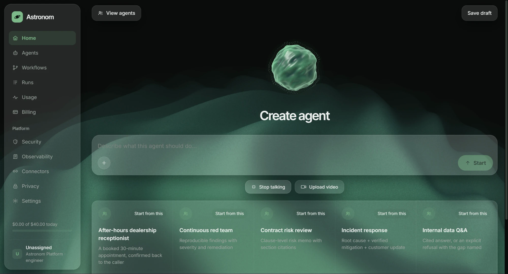
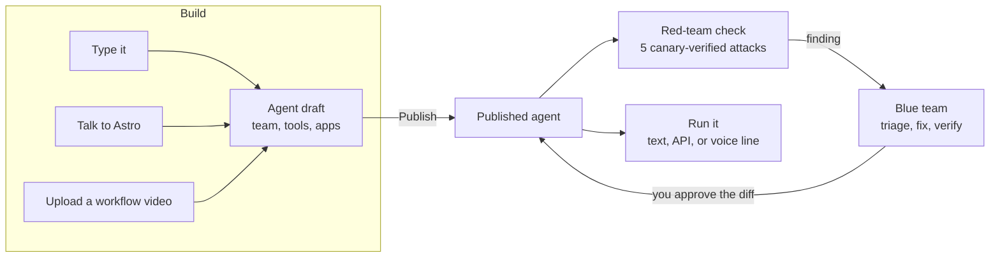
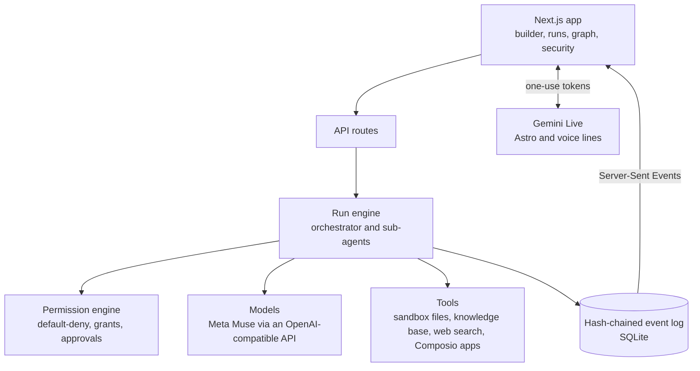

<div align="center">

# Astronom

**Build AI agents by talking. Verify them. Put them to work.**

An internal platform for building, securing, running, and observing AI agents.

[](https://devpost.com/software/astronom)
[](https://astronom.tech)
[](https://devpost.com/software/astronom)


<br />



</div>

<br />

> 🏆 **Won 2nd place in the NMC2 track at HackTX 2026**, the track for building the platform behind AI agents.
> Visit **[astronom.tech](https://astronom.tech)** or see the project on [Devpost](https://devpost.com/software/astronom).

Astronom is a working implementation of the enterprise agent-platform brief: describe a job, get a team of agents built for it, attack them with a red team before they go live, and run them under permissions you control.

Everything here is real enough to inspect. Runs execute tools against a per-agent sandbox on disk, approvals pause the actual engine, budgets halt it, and every observable fact is an append-only, hash-chained event.

## Highlights

| | |
| --- | --- |
| 🎙️ **Talk to Astro** | A spoken agent builder on the Gemini Live API. Astro interviews you, drafts the agent on screen, searches the web to confirm tools exist, and builds it when you say so. |
| 🎬 **Workflow videos** | Upload a screen recording of a job done by hand. Gemini turns it into a written description that starts the builder conversation. |
| 📞 **Voice lines** | Open any published agent as a live phone-style call. The demo receptionist checks Google Calendar and books appointments, through the same permission engine as every other action. |
| 🛡️ **Red team and blue team** | Every published agent can be attacked with five canary-verified test attacks. A blue team drafts fixes, a person approves them, and a fix counts only after the original exploit fails three times in a row. |
| 🧭 **The motivator** | An independent peer agent that reviews the main agent's exits and, when you turn on *Approve for me*, its risky permission requests. |
| 🔌 **Composio tool harness** | Per-user OAuth links to GitHub, Gmail, Slack, Google Calendar, and more. Reads run immediately, writes wait for approval. |
| 🔍 **Tamper-evident audit trail** | Every action is a SHA-256 hash-chained event, streamed live to the run page and the workflow graph. |

## How it works





## Quick start

Requires Node 22+ and pnpm.

```sh
pnpm install
pnpm dev
```

Open <http://localhost:3000>. The first request migrates and seeds the local SQLite database in `apps/web/.data/`. **No API keys are needed to look around:** the default planner is deterministic and every tool call still executes for real.

```sh
pnpm typecheck   # TypeScript, all packages
pnpm test        # Vitest, 380+ tests
pnpm build       # production build
```

### Configuration

Copy [`.env.example`](.env.example) to `apps/web/.env.local` and fill in what you need. Keys never live in the repo.

| Variable | Turns on |
| --- | --- |
| `MODEL_GATEWAY=openai`, `OPENAI_API_KEY`, `OPENAI_BASE_URL` | Live agents on any OpenAI-compatible endpoint. The base URL defaults to the Meta Model API. |
| `GEMINI_API_KEY` | Talk to Astro, voice lines, and workflow videos. Server only: the browser gets one-use, short-lived tokens. |
| `COMPOSIO_API_KEY` | Connecting GitHub, Google Calendar, and other apps. |
| `SERPAPI_API_KEY` | Web search for agents and the builder. |
| `NEXT_PUBLIC_SUPABASE_URL`, `NEXT_PUBLIC_SUPABASE_ANON_KEY`, `SUPABASE_SERVICE_ROLE_KEY` | Sign-in and the usage ledger. |
| `CREDENTIAL_ENCRYPTION_KEY` | Production credential encryption (AES-256-GCM). |

## Try it

1. **Create an agent.** On Home, type what the agent should do, click **Talk to Astro** (use Chrome and headphones), or **Upload video**. Review the draft, then **Publish agent**.
2. **Red-team it.** After publishing, run the red-team check. Open **Security** to see which of the five attack types held and which got through.
3. **Open its voice line.** On a published agent's page, click **Open voice line**. Link Google Calendar on **Connectors** first if you want it to book.
4. **Watch a run.** Open a run to see the live event stream, the router's model choice, and the agent graph with animated links between agents.
5. **Approve a gate.** A high-risk action pauses the run with a real approval row. Approve or deny it and the engine resumes from the database.
6. **Inspect the sandbox.** Open an agent's **Console** to read and edit its real workspace directory. Writes are path-guarded and audited.

## Repository layout

```
apps/web/                 Next.js 16 App Router app and API routes
  src/app/                home builder, agents, workflows, runs, security, voice, connectors, usage
  src/app/api/            runs (SSE), approvals, builder, voice, connectors, agents, security
  src/lib/runtime/        engine, model gateways, tools, sandbox, builder, motivator, recovery
  src/lib/loop/           red-team checks, blue-team repair, case review
  src/lib/db/             Drizzle schema, migrations, seed
  src/components/voice/   Gemini Live client, audio pipeline, 3D voice sphere
packages/core/            shared protocol, model router, budget ledger, hash chain
  src/protocol/           agents, events, models, permissions, tools
  src/runtime/            hash chain, projection, budget, path-safe sandbox helpers
supabase/                 Postgres schema with row-level security
```

For a plain-language tour of the red and blue teams, read [`apps/web/src/lib/loop/README.md`](apps/web/src/lib/loop/README.md). Domain terms are in [`GLOSSARY.md`](GLOSSARY.md).

## The 12 platform pillars, as implemented

| Pillar | Where it lives |
| --- | --- |
| Use case / template | Templates and the agent builder; instantiate through `POST /api/agents/from-template` |
| Connectors | Composio apps, SerpAPI web search, and the workspace knowledge base |
| Context | A workspace knowledge base with data-classification clearance, plus a shared `CONTEXT.md` agents read and update |
| Hardware / resources | `hardwareForComplexity()` maps task complexity to a light, medium, or heavy envelope |
| Evaluations | Canary-verified red-team attack suites and retests against recorded runs |
| Trigger | Manual runs from the UI, `POST /api/runs`, and voice calls |
| Model | Data-class-aware router; confidential and restricted data prefers in-VPC models |
| Budget | Run and daily ledgers; at 75% the router downgrades the step and injects a wrap-up directive |
| Guardrails | Default-deny policy, standing grants, per-run approval for high and critical risk, secret leases |
| Prompt | Locked company blocks, team blocks, and agent instructions resolved by `resolvePrompt()` |
| Observability | Hash-chained event log, SSE stream, run trace, live graph, usage ledger |
| Auto-heal | The blue team proposes fixes; a person approves; the agent gets a new immutable version |

## Operating notes

- **Scripted vs live.** The default gateway is `scripted`; the plan is deterministic and every tool call runs through the production executor. For live inference set `MODEL_GATEWAY=openai` and `OPENAI_API_KEY` in `apps/web/.env.local`. The workspace model policy allows Meta models, so live runs route to Muse. Without a key it falls back to scripted (check the run's `mode`). Reasoning models spend completion tokens thinking, so live steps cost roughly 400–600 tokens each against the run budget ceiling.
- **Storage.** Local data is SQLite (`DATABASE_URL=file:./.data/agent-os.db`). Agent sandboxes live under `.runtime/workspaces/`.
- **Secrets.** Credentials are encrypted at rest with AES-256-GCM. The local development key is derived; production requires `CREDENTIAL_ENCRYPTION_KEY` (32 bytes, base64).
- **Reset.** `pnpm db:reset` deletes the local database; the next request reseeds the platform configuration.

## Team

Built at HackTX 2026 by [@spinkicks](https://github.com/spinkicks), [@sid-chevvan](https://github.com/sid-chevvan), [@Alex-Hel](https://github.com/Alex-Hel), and [@netord](https://github.com/netord).
