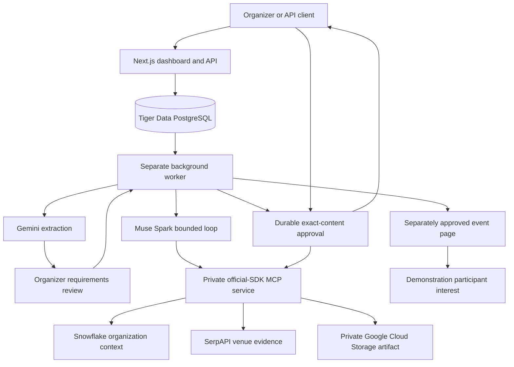

# Architecture and runtime guarantees

## State and execution

PostgreSQL stores agent drafts, immutable versions, run checkpoints, events, observed steps, approvals, artifacts, API key hashes, invoices, credits, and participant interest. Snowflake stores organization history and preference aggregates only. It is not used for application telemetry.

Each run pins an immutable version. Database triggers reject edits to published versions and approval action content. A worker uses row locks and `SKIP LOCKED` to claim queued or expired-lease runs. Each phase persists a checkpoint. The worker releases its lease while waiting for requirements or approval. Waiting does not occupy the worker.

The current implementation processes one phase at a time. It uses bounded coordinator and tool counts. Each remote call has a timeout. Active execution time accumulates separately from approval expiry. A recovered expired lease charges up to its 90-second lost interval to the active budget. Live phases reserve a full remote timeout before starting; a run can stop slightly before its configured deadline. Remote read retries may repeat inference or searches after a crash, but cannot duplicate a run debit or approved write.

Only observed model messages, tool-call envelopes, source results, and short decision summaries reach the inspector. Provider reasoning fields are discarded. The checkpoint has no private chain-of-thought. It is not returned by the API.

## Tool and credential boundary

The model can choose only `org_history` or `venue_search`. The worker validates argument schemas and checks the pinned version allowlist. The connector independently loads the run and its version before serving a read. Snowflake accepts a fixed parameterized SELECT, not model-written SQL. Search accepts query text, not an arbitrary endpoint URL.

Write tools accept a run ID and a stable approved action ID. They do not accept replacement content from the model. Private artifact writes read exact content from the approval record and use a stable GCS key with `ifGenerationMatch:0`. If a crash occurs after GCS creation, the retry reads and compares the existing object before recording the same artifact. A unique action primary key prevents duplicate artifact rows. Publishing an event page uses an atomic insert with the approval ID as its primary key.

Platform API keys are random and stored as SHA-256 hashes. They have workspace scopes. Model keys live in the worker; connector credentials live in the connector. The production web process has neither. The internal MCP secret is not a platform key. Dashboard mutation routes check the origin. Production sign-in uses a signed HTTP-only cookie, a shared workspace password, and an eight-hour session. This prototype does not implement enterprise identity.

## Transactions and ordering

Run creation locks the workspace row. It stores the idempotency record, run, event, and credit debit atomically. Repeating a key with different content conflicts. Approval decisions lock the run before the action. Repeating a decision returns its existing result. Rejection ends the run before a write can start.

Artifact writes hold the run row lock. Cancellation waits for an already-started approved write to finish; it then prevents further work. It does not undo an external write. This is an explicit serialization choice for the prototype. A production system could replace the long transaction with a fenced outbox and object-store result reconciliation.

Run event IDs provide ordered replay. SSE clients reconnect with the last observed ID. A successful read step is reused after recovery. Model and search requests may still repeat if a crash occurred before their durable observation was stored. Usage estimates can undercount these ambiguous provider calls.

## Time-series chart

Only completed observed steps insert `execution_metrics` records. There are no seeded metrics. Local development queries `date_trunc('hour', time)`. Tiger Data enables migration `002_timescale.sql` and queries `time_bucket('1 hour', time)`. The chart shows actual completed steps in the last 24 hours. Fixture executions are real local runtime events, but report zero provider tokens.

## Known limits

- Live sponsor calls, a real devnet transfer, Tiger Data, GCS, and Vultr deployment need user credentials and infrastructure. They have not been verified in this build.
- The event template uses a three-option event-plan schema. The Trees workspace supports bounded manual/adaptive trees with per-node model, mode, and read-tool choices. Arbitrary output schemas and cyclic graphs remain unsupported.
- Tree execution is sequential and read-only. Branches can be added, removed, and reconnected through the inspector. The canvas is not a drag-and-drop editor. See AGENT_TREES.md.
- Text-only completion tasks make one model call and do not use tools. They are deliberately narrower than the native runs API.
- The Snowflake SQL API adapter expects a synchronous result within 15 seconds and fails visibly on queued/asynchronous results. OAuth refresh, pagination, and very large histories need a later adapter layer.
- Live snippets are source evidence, not proof of venue price, capacity, accessibility or availability. The server forces these operational facts to remain unconfirmed. Recommendations and invitation drafts still need human review.
- The local PGlite socket serializes connections. It is for a small demo, not production concurrency. Use real PostgreSQL/Tiger Data for parallel worker deployments.
- Source retention, private data deletion, detailed audit identities, user roles, API rate limits, password throttling, email identity, per-user event consent, key expiry, and a production abuse budget need further work.
- Test-credit balances have no monetary value. There is no mainnet support, automatic wallet signing, refund policy, token price feed, or wallet secret custody.
- Cost uses a configured blended token estimate. It is not billing reconciliation. Raw inference retry costs can be unknown after a crash.
- A worker blocked in an approved external artifact write can delay cancellation until that write returns or its connector timeout ends.
- Public participant pages are only for demonstration use in this build. They contain no real participant list. The interest cookie deduplicates a browser action; it is not an identity system.
